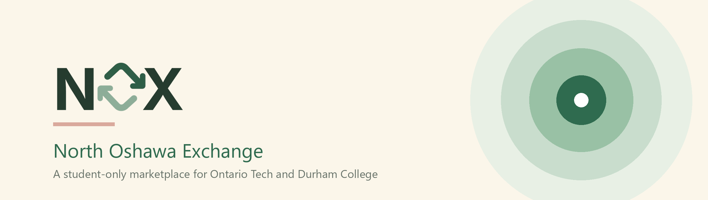
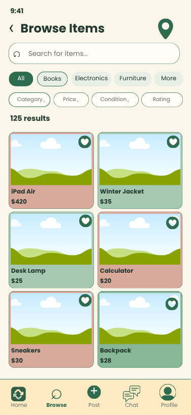
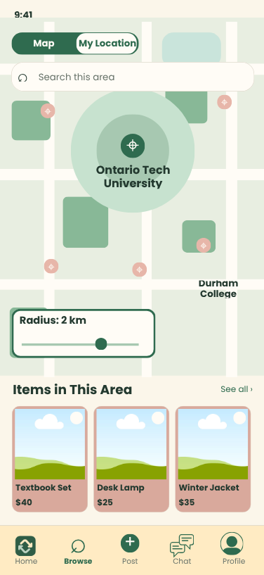
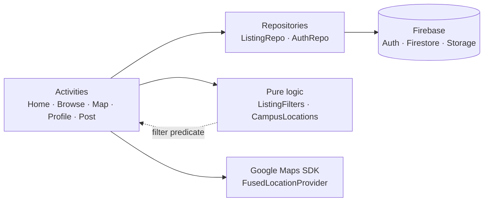

<div align="center">



<br>

**A student-only marketplace for Ontario Tech University and Durham College.**

Buy, sell, and exchange textbooks, electronics, furniture, and dorm supplies with people on your own campus.

<br>

[](#getting-started)
[](#tech-stack)
[](#tech-stack)
[](#tech-stack)
[](#testing)
[](#status)

<br>

[Overview](#overview) &nbsp;·&nbsp; [Design preview](#design-preview) &nbsp;·&nbsp; [Features](#features) &nbsp;·&nbsp; [Tech stack](#tech-stack) &nbsp;·&nbsp; [Architecture](#architecture) &nbsp;·&nbsp; [Getting started](#getting-started) &nbsp;·&nbsp; [Testing](#testing) &nbsp;·&nbsp; [Status](#status)

</div>

## Overview

Students at Ontario Tech and Durham College are constantly buying, selling, and trading the same things: textbooks, electronics, furniture, tickets, and dorm supplies. General platforms like Kijiji and Facebook Marketplace are not built for campus communities. Nobody is student-verified, sellers come from all over the region, and finding something near campus is guesswork. Students end up scrolling past irrelevant listings, arranging meetups with strangers, and missing deals from people in the same building.

**NOX closes the marketplace off.** Access requires an `@ontariotechu.net` or `@dcmail.ca` address, every listing carries a campus pickup location, and browsing runs on a pickup radius you drag on a map instead of a city name.

- **Verified students only.** Your school email decides whether you get an account, and access ends after your graduation month.
- **Distance is the filter that matters.** Set a radius from 0.5 to 10 km around campus, or anywhere you search for, and only see what you can actually carry home.
- **Real listings, real photos.** Post an item with up to five photos and the details a buyer needs.

## Design preview

<div align="center">


&nbsp;&nbsp;&nbsp;


</div>

> **These are design mockups of the intended experience, not screenshots of the running build.** The shipped app follows this layout and palette. The Rating filter and the "Items in This Area" list shown here were scoped out and not built.

## Features

**Accounts and access**

- Sign-up restricted to Ontario Tech and Durham College email domains, with the domain deciding which school lands on your profile
- Email verification before first use, plus password reset
- Automatic access expiry at the end of your graduation month, recalculated on every screen visit
- Every main screen re-checks access, so an expired or revoked account is caught even mid-session

**Finding things**

- Home feed with category chips, a Featured carousel, and a Recently Added carousel
- Live text search across item titles and descriptions
- Browse screen with expanding category pills, price bands, and condition filters
- Two-column results grid with a live result count, empty states, and a retry path when loading fails
- Save items with a heart from any listing card, then find them under Saved on your profile

**Campus map**

- One marker per listing on a custom-styled Google Map that keeps campus labels and hides business and transit clutter
- Translucent pickup radius you resize with a slider; markers outside it dim to 40% but stay tappable
- Device location button with a graceful campus fallback when permission is denied or no fix arrives
- Typed place and address search, so you can move the radius somewhere off campus
- Landscape layout that moves the map to one side and the controls to the other

**Posting**

- Item name, category, price, condition, description, and pickup location from a list of campus buildings
- Up to five photos from the gallery or the camera, uploaded to Firebase Storage
- Validation that reports every problem before anything uploads

**Motion and feedback**

- Screens cross-fade instead of cutting, and the cream background is painted from the first frame, so cold start matches the splash instead of flashing white
- Feeds, result grids, and the profile tabs stagger their cards in; a card dips under the finger and the heart pops on tap
- Item details slide up as a rounded sheet from the bottom edge, and the Browse category row grows in and out instead of snapping

## Tech stack

| Layer | Technology |
|---|---|
| Language | Kotlin |
| UI | Android Views, XML layouts, Material Components |
| Lists | RecyclerView, CardView, GridLayoutManager |
| Auth | Firebase Authentication, email and password with verification |
| Database | Cloud Firestore (`users/{uid}`, `listings/{id}`) |
| Media | Firebase Storage |
| Maps | Google Maps SDK for Android |
| Location | Google Play Services Location (FusedLocationProvider) |
| Place search | Android `Geocoder`, async API on 33+ with an executor fallback |
| Async | Kotlin coroutines, `kotlinx-coroutines-play-services` |
| Build | Gradle 9.6, Android Gradle Plugin 9.4.1 |
| Tests | JUnit 4, AndroidX Test, Espresso |

**SDK levels:** min 24 (Android 7.0), target 37, compile 37.

No Compose, Hilt, Retrofit, or MVVM framework. The app stays on the activity-and-XML model used in the course, which keeps the codebase readable for five people working in parallel.

## Architecture



Four ideas hold the codebase together:

**Repositories wrap Firebase.** `ListingRepo` and `AuthRepo` are the only classes that touch Firestore or Firebase Auth, so no screen talks to the backend directly.

**Filter logic has no Android imports.** `ListingFilters` implements a haversine distance function and a single match predicate over query, category, price, condition, and radius. `CampusLocations` resolves a listing to coordinates. Both are plain Kotlin, which is why they have direct unit tests.

**Filter state is one immutable object.** `BrowseFilters` carries the query, category, price band, condition, and optional centre and radius. It is `Parcelable`, so it survives rotation and travels between Browse and the map through an Activity Result contract.

**Distance filtering happens on the client.** Firestore has no native geographic query, so the app fetches the listing set and applies the haversine filter locally. That is fine at campus scale.

### Project structure

```
app/src/main/java/com/example/noxapp/
├── auth/            Sign-up, login, verification, access state machine
├── data/            Firestore access, distance filtering, campus coordinates
├── models/          Listing, UserProfile, BrowseFilters
├── adapters/        Listing, category, and filter pill adapters
├── ui/              Shared item detail sheet, motion helpers, activity helpers
├── postlisting/     Post flow (owns a second Listing model)
├── MainActivity.kt      Home feed
├── BrowseActivity.kt    Filtered search
├── MapActivity.kt       Campus map and pickup radius
└── ProfileActivity.kt   Profile and saved items
```

## Getting started

### Prerequisites

- Android Studio with the compile SDK for API 37
- JDK 25. The Gradle toolchain downloads it automatically through the foojay resolver if it is missing.
- A Firebase project
- A Google Maps API key
- An emulator that includes **Google Play services**. A plain AOSP image will not run the map or the location button.

### 1. Clone

```bash
git clone https://github.com/Vyoma22/NOXApp.git
cd NOXApp
```

### 2. Point the build at your SDK and Maps key

Create `local.properties` in the project root. It is gitignored, and nothing builds without it:

```properties
sdk.dir=C\:\\path\\to\\Android\\Sdk
MAPS_API_KEY=your_maps_api_key_here
```

The key is injected into the manifest at build time through `manifestPlaceholders`. In Google Cloud, restrict it to the `com.example.noxapp` package and the Maps SDK for Android, and register your debug SHA-1 from `./gradlew signingReport`.

### 3. Connect Firebase

- Put `google-services.json` in `app/`.
- Enable **Email/Password** sign-in under Authentication.
- Create a **Firestore** database.
- Enable **Storage**.

### 4. Build and run

```bash
./gradlew assembleDebug     # debug APK
./gradlew installDebug      # install on a connected device or emulator
```

### 5. Add some listings

The app does **not** seed itself. A fresh Firestore database produces an empty feed on every screen, so add a few `listings` documents before demonstrating Browse or the map.

Then sign up with a real `@ontariotechu.net` or `@dcmail.ca` mailbox you can open, confirm the verification email, and you are in.

### Troubleshooting

| Symptom | Cause |
|---|---|
| Map is blank with a Google error in logcat | `MAPS_API_KEY` missing from `local.properties`, or the key is not restricted to this package and debug SHA-1 |
| Feed and map are both empty | No `listings` documents in Firestore |
| Location button always falls back to campus | Emulator has no location fix, or the emulator image lacks Play services |
| Sign-up refuses a valid address | Only `@ontariotechu.net` and `@dcmail.ca` are accepted |

## Testing

```bash
./gradlew testDebugUnitTest          # JVM logic
./gradlew connectedDebugAndroidTest  # needs an emulator with Play services
```

Both suites pass: **39 unit tests** and **26 instrumented tests**, 65 in total.

| Suite | Tests | Covers |
|---|:--:|---|
| `ListingFiltersTest` | 16 | Query, category, condition, exact price boundaries, radius boundary, combined filters |
| `MapActivityTest` | 11 | Radius state, result contract, marker behaviour |
| `HaversineTest` | 6 | Known distances, symmetry, identical points |
| `EmailValidatorTest` | 5 | Domain allowlist, malformed addresses |
| `CampusLocationsTest` | 5 | Explicit coordinates and pickup-location fallback |
| `BrowseActivityTest` | 6 | Filter interaction, chip expansion notifications, and result rendering |
| `MapLocationSearchTest` | 5 | Place search against a fake geocoder |
| `GradDateTest` | 2 | Month rollover and year boundary |
| `LocationSearchTest` | 2 | Result filtering and deduplication |
| `PickupPreferenceRemovalTest` | 2 | Guards a deliberately removed feature |
| `RemovedPickupPreferenceUiTest` | 2 | Guards a deliberately removed feature |
| `ItemDetailDialogTest` | 1 | Dialog content and contact action |
| Template placeholders | 2 | `ExampleUnitTest`, `ExampleInstrumentedTest` |

## Status

NOX is under active development as a course project. What works today: verified sign-up and sign-in, the Home feed, Browse with filters, the campus map with radius and place search, the profile with saved items, and photo upload on the post screen.

Known gaps:

- **Posting does not reach the feeds yet.** The post flow writes `name`, `location`, and `imageUrls`, while every feed reads `title`, `pickupLocation`, and `imageUrl`. The two `Listing` models need to be reconciled. This is the top priority.
- **Listing photos do not render.** `ListingAdapter` declares an `ImageView` but never binds it, and no image-loading library is included. Coil or Glide needs adding.
- **Chat is not built.** The Chat tab shows a placeholder toast, and the item dialog's email hand-off is the current stand-in.
- **Map pins fall back to campus anchors.** Coordinates are not captured at post time, so pins cluster at the two campus centres instead of marking buildings.
- **Video and voice search are not implemented.** Both appear in the project proposal.
- **The Sold tab is always empty.**
- **The pickup radius is session-only.** Persisting it to the profile was built and then deliberately removed.

<sub>Academic project. Not licensed for redistribution.</sub>
